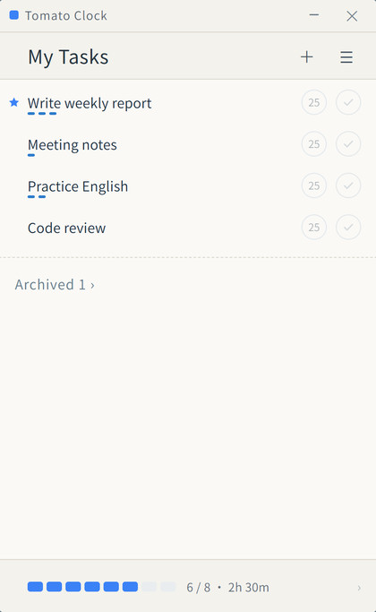
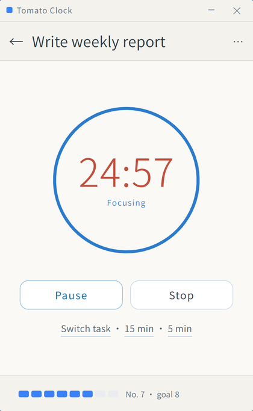
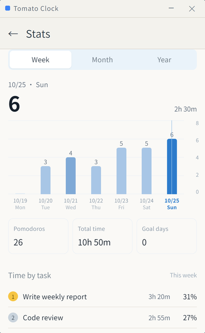
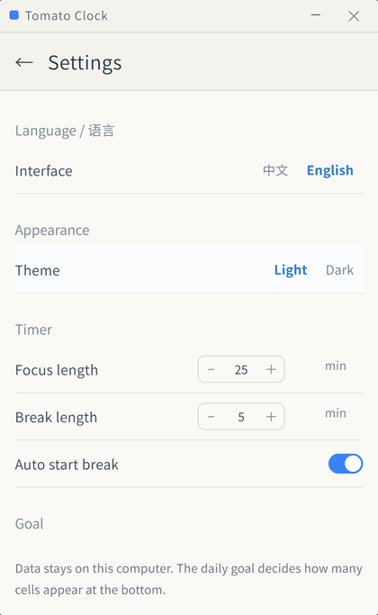

# Tomato Clock

[中文](README.md) | **English**

A minimal, local-first pomodoro timer for Windows: tasks → timer → statistics. Everything stays on your own machine — no account, no sync, no network calls.

| Tasks | Focus |
|---|---|
|  |  |
| **Statistics** | **Settings** |
|  |  |

Full introduction (why it exists, what it does, how the work was split between the human and the model, model version): [Chinese introduction](docs/intro-zh.md) · [English introduction](docs/intro-en.md)

---

## Features

- **Tasks**: create, rename, delete, archive/restore, star. Hover a row to reveal `5 / 15 / 25`-minute chips and a done button
- **Timer**: ring countdown with pause/resume/stop; a break can start automatically when focus ends
- **Statistics**: week / month / year bar charts, totals, goal days, and time share per task
- **History**: per-day list plus a heatmap of where the time went
- **Appearance**: light / dark theme, Chinese / English UI
- **Tray**: keeps running after the window is closed; the icon shows the remaining minutes
- **Your data**: configurable data folder, JSON export/import, automatic backup before clearing

## Shortcuts

| Action | Shortcut |
|---|---|
| Statistics | `Ctrl + 1` |
| Settings | `Ctrl + 2` |
| Reset window size | `Ctrl + 0` |
| Start / pause (timer page) | `Space` |
| Back to task list | `Esc` |
| Show / hide window (global) | `Ctrl + Alt + P` |

## Install

**Don't want to install Node.js or build it yourself?** Download `TomatoClock-Setup-1.0.3.exe` from [Releases](https://github.com/SportsHappyDream/tomato-clock/releases) and run it — it installs per user and needs no administrator rights.

The build is not code-signed, so Windows SmartScreen may warn about an unknown publisher — choose **More info → Run anyway**.

## Data & Privacy

- Data file: `%APPDATA%\tomato-clock\data.json` (the folder is configurable in Settings)
- Backups: `backup-*.json` is written automatically before a data-shape change or a clear
- Window position and size: `window-state.json`
- Multiple profiles / demos: launch with `--data-dir=<path>` to use an isolated data folder — the default location is not read, written, or migrated
- Nothing is sent over the network; there is no telemetry

## Build from source

Requires Node.js 18+.

```bash
cd app
npm install
npm start            # run in dev mode
npm run dist         # build the installer into app/dist
```

> Behind a slow network, set the mirrors first:
> `set ELECTRON_MIRROR=https://npmmirror.com/mirrors/electron/`
> `set ELECTRON_BUILDER_BINARIES_MIRROR=https://npmmirror.com/mirrors/electron-builder-binaries/`

## Project layout

```
.
├── app/                 Electron application (source)
│   ├── main.js          main process: window, tray, timer engine, data I/O
│   ├── preload.js       IPC bridge
│   ├── renderer/        UI: app.js / app.css / i18n.js
│   └── assets/          icons and tray images
├── docs/                screenshots, sample data, both introductions
└── LICENSE              MIT
```

The timer engine runs in the main process, so closing the window does not lose a running pomodoro; `Space`, `Esc` and `Ctrl+1/2/0` are handled in the renderer or the main process depending on context.

## License

[MIT](LICENSE) © 2026 SportsHappy

Trademark note: this project is not affiliated with Pomodoro Technique® or RoundPie; it is an independent personal implementation.
