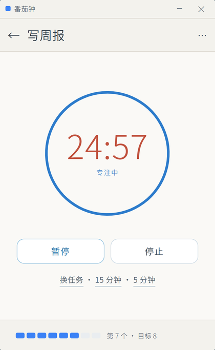
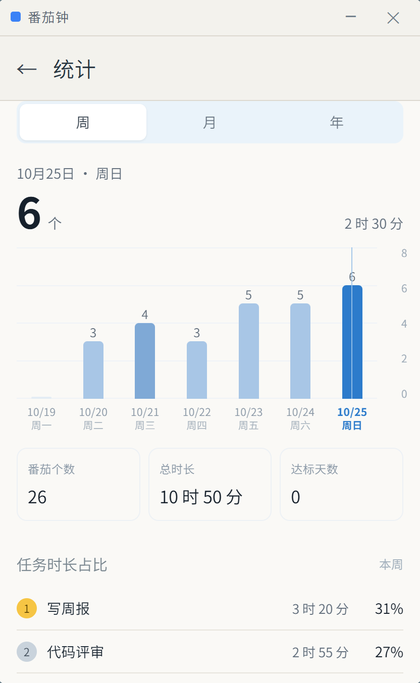
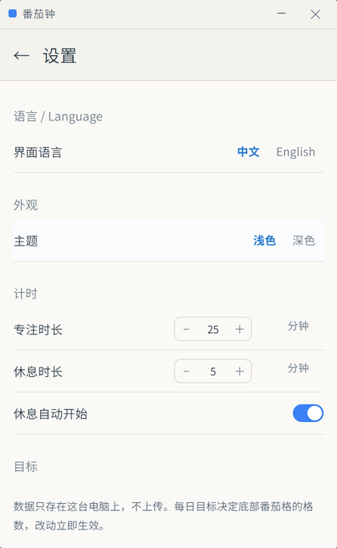

# 番茄钟 · Tomato Clock

一个本地优先的极简番茄钟桌面应用：任务 → 计时 → 统计，全部数据只存在自己的电脑上。
无账号、无同步、无网络请求。

A minimal, local-first pomodoro timer for Windows: tasks → timer → statistics.
No account, no cloud, no network access. All data stays on your machine.

| 任务 Tasks | 专注 Focus |
|---|---|
|  |  |
| **统计 Stats** | **设置 Settings** |
|  |  |

---

## 中文

番茄钟是一个给 Windows 用的极简桌面计时器，只做三件事：列出今天要做的事、专心做完一段、回头看时间花在了哪里。

它起源于一个很小的不快：不少番茄钟把"查看历史记录"放进付费会员，而我只是想知道这个月究竟专注了多少小时。于是索性自己写一个——数据存在本机、不要账号、不联网、也不订阅。

功能上刻意保持克制：没有项目管理、没有协作、没有排行榜。打开就是今天的任务列表，鼠标移到某一行才出现 5 / 15 / 25 分钟，点一下开始；专注结束可自动进入休息；统计页按周、月、年给出每天的投入与每个任务的时长占比；历史页用热力图看长期节奏。界面提供浅色与深色两套，中文与英文双语。

### 开发方式与分工

这个项目由人和模型协作完成，分工如下：

- **dreamworld（作者）**：提出需求与目标，决定产品方向，决定开源与发布方式。
- **DeepSeek Harness 桌面端中的 deepseek-flash 模型**：承担具体实现与排查——Electron 主进程（窗口、托盘、计时引擎、数据读写）、渲染层界面与样式、中英文文案、打包与发布脚本、文档撰写；遇到问题负责取证定位（截图比对、像素取样、窗口句柄排查）。

协作方式可以概括为"人定方向、模型动手、人验收"。界面上的每一处细节都来自作者自己的截图与复查意见；模型产出并不被认为天然正确——它确实出过错（例如一次准备示例截图时替换数据把作者的真实记录覆盖了，最后从应用自动备份恢复），所以每次改动都以作者的实际使用验收为准。

开发使用的模型版本记录如下：`deepseek-flash`（显示名 DeepSeek-V4.1-Flash），服务方 `deepseek-account`，推理档位 `high`，上下文 100 万 tokens。日期：2026 年 10 月。

---

## English

Tomato Clock is a minimal desktop pomodoro timer for Windows. It does three things: keep today's tasks in view, run one focused stretch at a time, and show where the hours actually went.

It started from a small irritation: several pomodoro apps hide "view your history" behind a paid tier, and all I wanted was to know how many hours I had focused this month. So I wrote my own — data stays on the machine, no account, no network, no subscription.

The feature set is deliberately small: no project management, no collaboration, no leaderboards. Open the app and today's list is there; hover a row and 5 / 15 / 25-minute sessions appear; one click starts the timer, and a break can follow automatically. Statistics break the time down by week, month or year, with per-task share; history adds a heatmap for the longer rhythm. Light and dark themes, Chinese and English UI.

### How it was built

The project is a collaboration between a human and a model:

- **dreamworld (author)**: defined the requirements and goals, set the product direction, and decided to open-source and publish it.
- **The `deepseek-flash` model inside DeepSeek Harness (desktop)**: did the implementation and diagnosis — Electron main process (window, tray, timer engine, data storage), renderer UI and styling, Chinese/English copy, packaging and release scripts, documentation — and gathered evidence when something broke (screenshot comparison, pixel sampling, window-handle inspection).

The loop is simple: the human sets the direction, the model does the work, the human accepts the result. Every visual detail in the current version came from the author's own screenshots and follow-up notes. Model output is not assumed correct — it has made real mistakes (one round of preparing demo screenshots overwrote the author's own records, later recovered from the app's automatic backup), which is why each change is verified in real use before it ships.

Model version used for development: `deepseek-flash` (display name DeepSeek-V4.1-Flash), provider `deepseek-account`, reasoning effort `high`, 1M-token context. Date: October 2026.

---

## 功能 Features

**中文**

- **任务管理**：新建、重命名、删除、归档/恢复、星标重点；悬停任务行即显示 `5 / 15 / 25` 分钟与完成按钮
- **番茄计时**：圆环倒计时，支持暂停/继续/停止；专注结束可自动进入休息
- **统计**：周 / 月 / 年三种视图，柱状图按天对比；番茄个数、总时长、达标天数；任务时长占比排行
- **历史**：按天记录，热力图一眼看出投入分布
- **外观**：浅色 / 深色主题，中英文界面
- **托盘**：窗口关闭后仍在托盘运行，图标显示本次番茄剩余分钟数
- **数据自主**：数据目录可改；支持导出 / 导入 JSON；清空数据前自动备份

**English**

- **Tasks**: create, rename, delete, archive/restore, star. Hover a row to reveal `5 / 15 / 25`-minute chips and a done button
- **Timer**: ring countdown with pause/resume/stop, optional auto-start break
- **Statistics**: week / month / year bar charts, totals, goal days, and time share per task
- **History**: per-day list plus a heatmap
- **Appearance**: light / dark theme, Chinese / English UI
- **Tray**: keeps running when the window is closed; the icon shows remaining minutes
- **Your data**: configurable data folder, JSON export/import, automatic backup before clearing

## 快捷键 Shortcuts

| 功能 | 快捷键 |
|---|---|
| 统计 Statistics | `Ctrl + 1` |
| 设置 Settings | `Ctrl + 2` |
| 重置窗口大小 Reset window size | `Ctrl + 0` |
| 开始 / 暂停（计时页）Start / pause (timer page) | `Space` |
| 返回任务列表 Back to task list | `Esc` |
| 显示 / 隐藏窗口 Show / hide window（全局） | `Ctrl + Alt + P` |

## 安装 Install

**不想装 Node.js / 不想自己构建**：直接从 [Releases](https://github.com/dreamworld2023/tomato-clock/releases) 下载 `TomatoClock-Setup-1.0.1.exe`，双击安装即可（按用户安装，不需要管理员权限）。

安装包未做代码签名，Windows SmartScreen 可能提示"未知发布者"：点 **更多信息 → 仍要运行** 即可。

Don't want to build it yourself? Download `TomatoClock-Setup-1.0.1.exe` from [Releases](https://github.com/dreamworld2023/tomato-clock/releases) and run it — it installs per user and needs no administrator rights.

The build is not code-signed, so Windows SmartScreen may warn about an unknown publisher — choose **More info → Run anyway**.

## 数据与隐私 Data & Privacy

- 数据文件：`%APPDATA%\tomato-clock\data.json`（可在设置里改目录）
- 备份：修改数据结构或清空数据前自动写入 `backup-*.json`
- 窗口位置与大小：`window-state.json`
- 不经网络发送任何内容，不含统计埋点

Data lives in `%APPDATA%\tomato-clock\data.json` (folder is configurable). Nothing is sent over the network and there is no telemetry.

## 从源码构建 Build from source

需要 Node.js 18+。

```bash
cd app
npm install
npm start            # 开发运行 dev mode
npm run dist         # 打包安装包，输出到 app/dist
```

> 国内网络可先设置镜像：
> `set ELECTRON_MIRROR=https://npmmirror.com/mirrors/electron/`
> `set ELECTRON_BUILDER_BINARIES_MIRROR=https://npmmirror.com/mirrors/electron-builder-binaries/`

## 目录结构 Project layout

```
.
├── app/                 Electron 应用（源码）
│   ├── main.js          主进程：窗口、托盘、计时引擎、数据读写
│   ├── preload.js       IPC 桥
│   ├── renderer/        界面：app.js / app.css / i18n.js
│   └── assets/          图标与托盘图
├── docs/                截图与示例数据
└── LICENSE              MIT
```

计时引擎运行在主进程，关闭窗口不会丢失正在进行的番茄；`Space`、`Esc`、`Ctrl+1/2/0` 由主进程或渲染进程按场景处理。

## 许可 License

[MIT](LICENSE) © 2026 dreamworld

第三方名称说明：本项目与 Pomodoro Technique®、RoundPie 等产品无关联，仅为独立的个人实现。
