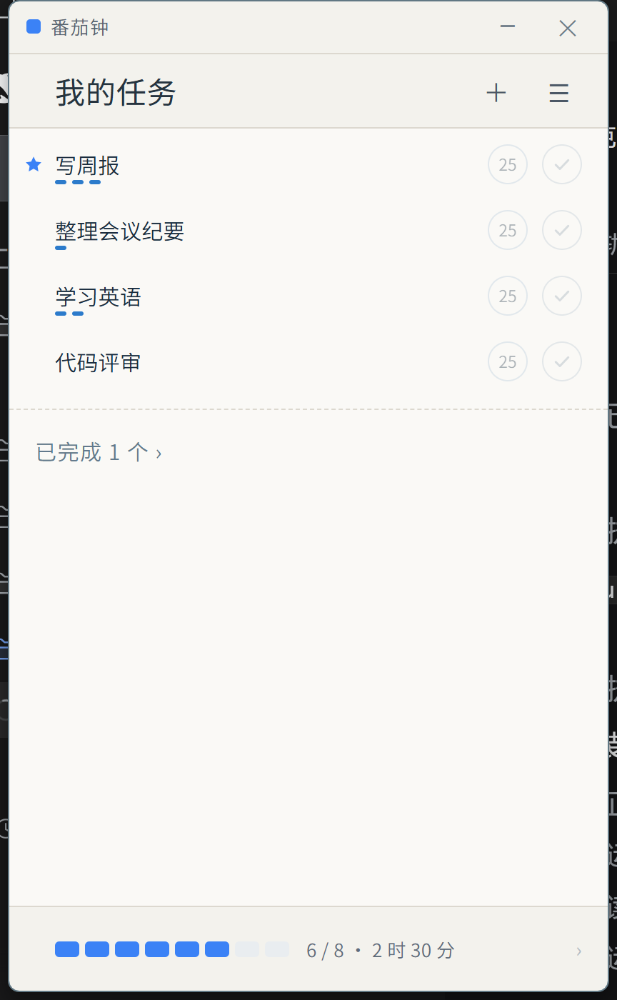
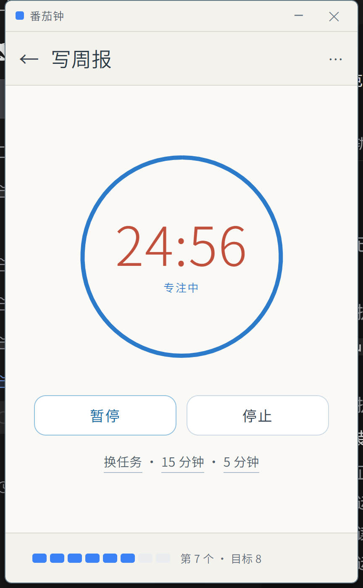
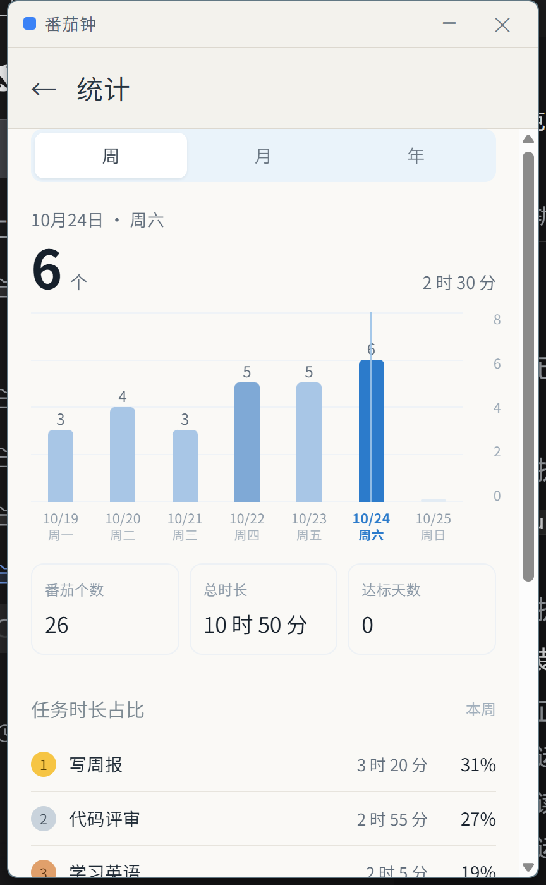

# 番茄钟 · Tomato Clock

一个本地优先的极简番茄钟桌面应用：任务 → 计时 → 统计，全部数据只存在自己的电脑上。
无账号、无同步、无网络请求。

A minimal, local-first pomodoro timer for Windows: tasks → timer → statistics.
No account, no cloud, no network access. All data stays on your machine.



| 计时 | 统计 |
|---|---|
|  |  |

---

## 功能 Features

**中文**

- **任务管理**：新建、重命名、删除、归档/恢复、星标重点；悬停任务行即显示 `5 / 15 / 25` 分钟与完成按钮
- **番茄计时**：圆环倒计时，支持暂停/继续/停止；专注结束可自动进入休息
- **统计**：周 / 月 / 年三种视图，柱状图按天对比；番茄个数、总时长、达标天数；任务时长占比排行
- **历史**：按天记录，热力图一眼看出投入分布
- **外观**：浅色 / 深色主题，中英文界面
- **托盘**：窗口关闭后仍在托盘运行，图标显示本次番茄剩余分钟数
- **数据自主**：数据目录可改；支持导出 / 导入 JSON；清空数据前自动备份

**English**

- **Tasks**: create, rename, delete, archive/restore, star. Hover a row to reveal `5 / 15 / 25`-minute chips and a done button
- **Timer**: ring countdown with pause/resume/stop, optional auto-start break
- **Statistics**: week / month / year bar charts, totals, goal days, and time share per task
- **History**: per-day list plus a heatmap
- **Appearance**: light / dark theme, Chinese / English UI
- **Tray**: keeps running when the window is closed; the icon shows remaining minutes
- **Your data**: configurable data folder, JSON export/import, automatic backup before clearing

## 快捷键 Shortcuts

| 功能 | 快捷键 |
|---|---|
| 统计 Statistics | `Ctrl + 1` |
| 设置 Settings | `Ctrl + 2` |
| 重置窗口大小 Reset window size | `Ctrl + 0` |
| 开始 / 暂停（计时页）Start / pause (timer page) | `Space` |
| 返回任务列表 Back to task list | `Esc` |
| 显示 / 隐藏窗口 Show / hide window（全局） | `Ctrl + Alt + P` |

## 安装 Install

从 [Releases](../../releases) 下载 `番茄钟 Setup x.y.z.exe`，运行安装（按用户安装，不需要管理员权限）。

安装包未做代码签名，Windows SmartScreen 可能提示"未知发布者"：点 **更多信息 → 仍要运行** 即可。

Download the installer from [Releases](../../releases). It installs per user and needs no administrator rights.

The build is not code-signed, so Windows SmartScreen may warn about an unknown publisher — choose **More info → Run anyway**.

## 数据与隐私 Data & Privacy

- 数据文件：`%APPDATA%\tomato-clock\data.json`（可在设置里改目录）
- 备份：修改数据结构或清空数据前自动写入 `backup-*.json`
- 窗口位置与大小：`window-state.json`
- 不经网络发送任何内容，不含统计埋点

Data lives in `%APPDATA%\tomato-clock\data.json` (folder is configurable). Nothing is sent over the network and there is no telemetry.

## 从源码构建 Build from source

需要 Node.js 18+。

```bash
cd app
npm install
npm start            # 开发运行 dev mode
npm run dist         # 打包安装包，输出到 app/dist
```

> 国内网络可先设置镜像：
> `set ELECTRON_MIRROR=https://npmmirror.com/mirrors/electron/`
> `set ELECTRON_BUILDER_BINARIES_MIRROR=https://npmmirror.com/mirrors/electron-builder-binaries/`

## 目录结构 Project layout

```
.
├── app/                 Electron 应用（源码）
│   ├── main.js          主进程：窗口、托盘、计时引擎、数据读写
│   ├── preload.js       IPC 桥
│   ├── renderer/        界面：app.js / app.css / i18n.js
│   └── assets/          图标与托盘图
├── docs/                截图与示例数据
├── LICENSE              MIT
└── 创作目录说明.md       本地创作过程与设计记录（不入库内容见 .gitignore）
```

计时引擎运行在主进程，关闭窗口不会丢失正在进行的番茄；`Space`、`Esc`、`Ctrl+1/2/0` 由主进程或渲染进程按场景处理。

## 许可 License

[MIT](LICENSE) © 2026 dingm

第三方名称说明：本项目与 Pomodoro Technique®、RoundPie 等产品无关联，仅为独立的个人实现。
