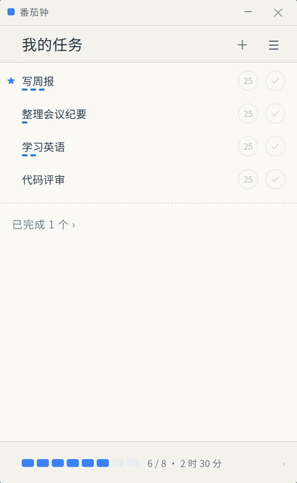

# Tomato Clock · English Introduction

[中文介绍](intro-zh.md) · [Back to README](../README.md)

---

Tomato Clock is a minimal desktop pomodoro timer for Windows. It does three things: keep today's tasks in view, run one focused stretch at a time, and show where the hours actually went.

It started from a small irritation: several pomodoro apps hide "view your history" behind a paid tier, and all I wanted was to know how many hours I had focused this month. So I wrote my own — data stays on the machine, no account, no network, no subscription.

The feature set is deliberately small: no project management, no collaboration, no leaderboards. Open the app and today's list is there; hover a row and 5 / 15 / 25-minute sessions appear; one click starts the timer, and a break can follow automatically. Statistics break the time down by week, month or year, with per-task share; history adds a heatmap for the longer rhythm. Light and dark themes, Chinese and English UI.

## How it was built

The project is a collaboration between a human and a model:

- **dreamworld (author)**: defined the requirements and goals, set the product direction, and decided to open-source and publish it.
- **The `deepseek-flash` model inside DeepSeek Harness (desktop)**: did the implementation and diagnosis — Electron main process (window, tray, timer engine, data storage), renderer UI and styling, Chinese/English copy, packaging and release scripts, documentation — and gathered evidence when something broke (screenshot comparison, pixel sampling, window-handle inspection).

The loop is simple: the human sets the direction, the model does the work, the human accepts the result. Every visual detail in the current version came from the author's own screenshots and follow-up notes. Model output is not assumed correct — it has made real mistakes (one round of preparing demo screenshots overwrote the author's own records, later recovered from the app's automatic backup), which is why each change is verified in real use before it ships.

Model version used for development: `deepseek-flash` (display name DeepSeek-V4.1-Flash), provider `deepseek-account`, reasoning effort `high`, 1M-token context. Date: October 2026.
